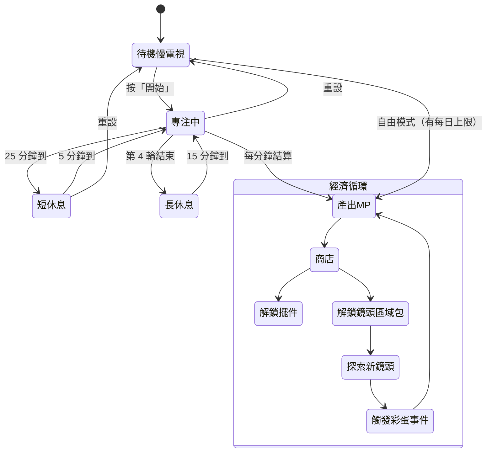
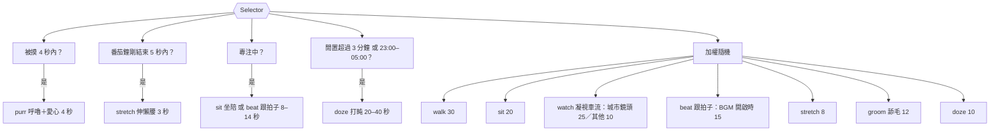
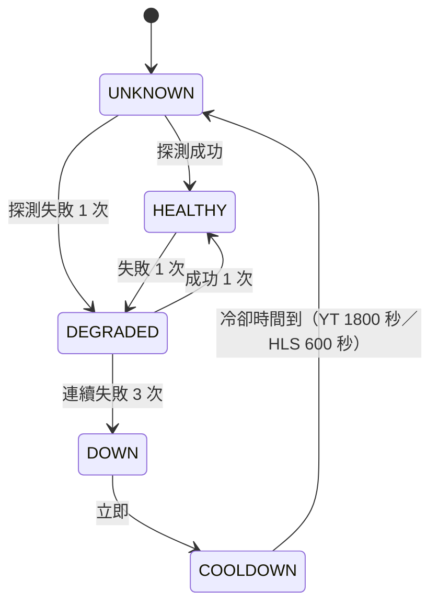
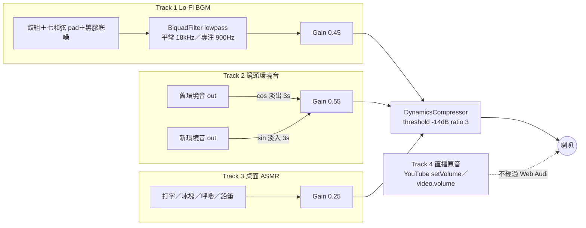
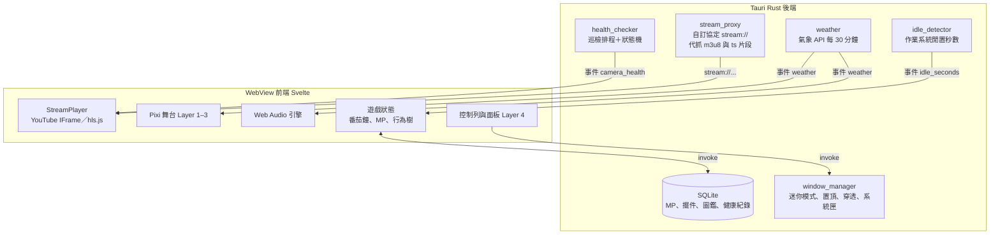

# 台灣慢電視漫遊者（Lo-Fi Taiwan Patrol）企劃與技術藍圖

> 版本 0.1｜對應程式：`build_cameras.py`（資料管線）、`cameras.json`（579 台鏡頭）、`index.html`（MVP 原型）
> 本文件所有數值都與目前的程式碼一致；程式裡的常數名稱以 `程式碼字型` 標出，方便對照修改。

---

## 目錄

1. [模組一：遊戲機制與系統設計（GDD）](#模組一遊戲機制與系統設計gdd)
2. [模組二：鏡頭資料庫分類法與資料管線](#模組二鏡頭資料庫分類法與資料管線)
3. [模組三：視覺風格與 UI/UX 規範](#模組三視覺風格與-uiux-規範)
4. [模組四：動態音訊引擎架構](#模組四動態音訊引擎架構)
5. [模組五：技術選型與系統架構](#模組五技術選型與系統架構)
6. [模組六：MVP 原型說明](#模組六mvp-原型說明)
7. [已知風險與待確認事項](#已知風險與待確認事項)

---

## 模組一：遊戲機制與系統設計（GDD）

### 1.1 產品定位

| 項目 | 規格 |
|---|---|
| 類型 | 放置型／療癒系桌面伴讀軟體（Desktop Companion + Slow TV） |
| 目標情境 | 讀書、寫程式、工作時開在第二螢幕或螢幕角落，單次使用 2–8 小時 |
| 核心承諾 | 「現在這一刻，台灣某個角落正在發生的真實畫面」＋不打擾的陪伴感 |
| 平台 | Windows 10/11、macOS 12+（首發）；Linux 為次要目標 |
| 單局長度 | 無局的概念；以番茄鐘 25 分鐘為最小獎勵單位 |

### 1.2 核心循環（Core Loop）



循環的五個階段：

1. **專注／放置**：開番茄鐘專注（主要收益），或開自由慢電視模式掛著（次要收益，有每日上限）。
2. **產出心靈點數（MP）**：每秒依時間戳累積，背景分頁或視窗最小化都不會少算。
3. **購買／解鎖**：MP 可以買桌面擺件（Layer 3），或解鎖鏡頭區域包。
4. **探索新鏡頭**：解鎖的區域會加入智慧輪播池；第一次看到某台鏡頭會記進「巡邏圖鑑」。
5. **觸發彩蛋事件**：由真實時間、真實鏡頭、真實天氣觸發（見 1.7），給一次性 MP 和圖鑑徽章，回頭推動下一輪探索。

### 1.3 伴讀專注系統：數值設計

對應 `index.html` 裡的 `MP_RULES`：

| 參數 | 數值 | 說明 |
|---|---|---|
| `focusPerMin` | 1.0 MP／分 | 番茄鐘專注中 |
| `breakPerMin` | 0.2 MP／分 | 番茄鐘休息中（鼓勵休息，但不鼓勵一直休息） |
| `freePerMin` | 0.4 MP／分 | 自由慢電視模式 |
| `sessionBonus` | +10 MP | 完成一輪 25 分鐘專注 |
| `comboMultiplier` | ×1.0／×1.1／×1.2／×1.5 | 連續第 1／2／3／4 輪的專注收益倍率，按「重設」歸零 |
| `freeDailyCap` | 120 MP／日 | 自由模式每日上限（約 5 小時），防止整天掛著刷點 |

**收益試算**

| 情境 | 時間 | MP | 每小時 |
|---|---|---|---|
| 番茄鐘一輪（專注 25 分＋短休 5 分） | 30 分 | 25×1.0＋10＋5×0.2 = **36** | 72 |
| 番茄鐘完整 4 輪（含 15 分長休） | 130 分 | 專注 25×(1.0+1.1+1.2+1.5)=120；獎勵 10×4.8=48；休息 (15+15)×0.2=6 → **174** | 80.3 |
| 自由慢電視 | 60 分 | 60×0.4 = **24** | 24 |

結論：認真專注的收益約是掛機的 **3.3 倍**，但掛機仍然有收益，玩家不會覺得「只是開著」被懲罰。

**商店價格表（第一版）**

| 擺件／解鎖 | 價格 | 首次可負擔時間（只用番茄鐘） | 效果 |
|---|---|---|---|
| 綠色乖乖 | 50 MP | 第 2 輪 | 斷流後自動換台的等待從 4 秒縮短為 1 秒（台灣機房文化梗） |
| 珍珠奶茶 | 60 MP | 第 2 輪 | 解鎖 ASMR「冰塊晃動」音效；寵物偶爾會去聞 |
| 大同電鍋 | 80 MP | 第 3 輪 | 長休息時冒蒸氣，播放開關「喀」一聲 |
| 復古檯燈 | 120 MP | 第 4 輪 | 夜間時段（19:00–05:00）桌面暖光，可開關 |
| 綠色郵筒 | 150 MP | 第 5 輪 | 每日第一次開啟時有「明信片」：昨日巡邏摘要 |
| 公車造型計時器 | 200 MP | 第 6 輪 | 番茄鐘外觀換成公車跑馬燈 |
| 區域包：東海岸日出線 | 300 MP | 約第 9 輪 | 解鎖花蓮、臺東海岸鏡頭 |
| 區域包：離島 | 500 MP | 約第 14 輪 | 解鎖澎湖、金門、馬祖、綠島鏡頭 |
| 區域包：高山 | 400 MP | 約第 12 輪 | 解鎖合歡山、阿里山、太平山、拉拉山 |

起始免費內容：北部（臺北、新北、基隆、桃園）全部鏡頭，加上每個分類各 2 台「試看」鏡頭。

### 1.4 角色動態反饋

角色（讀書的人）有 5 個狀態。判定每 1 秒執行一次，由上往下，第一個成立的條件勝出：

| 優先序 | 狀態 | 觸發條件 | 動畫 | 持續 |
|---|---|---|---|---|
| 1 | 摸寵物 | 玩家點擊寵物後 4 秒內 | 伸手摸頭，寵物進入 `purr` | 4 秒 |
| 2 | 伸懶腰 | 番茄鐘專注階段結束後 5 秒內 | 雙手上舉、打哈欠 | 3 秒 |
| 3 | 專注中 | 番茄鐘在專注階段，且最近 3 分鐘內有鍵盤或滑鼠輸入 | 翻書，每 40–90 秒喝一口手搖飲 | 持續 |
| 4 | 放空 | 專注階段但已經 3 分鐘以上沒有輸入；或非番茄鐘時 3–10 分鐘沒有輸入 | 托腮看窗外（看向 Layer 0） | 持續 |
| 5 | 打瞌睡 | 超過 10 分鐘沒有輸入；或本地時間 23:00–05:00 且超過 3 分鐘沒有輸入 | 頭一點一點，冒 Zzz | 持續，有輸入立刻醒來（醒來動畫 0.8 秒） |

「輸入」的判定：桌面版用作業系統的閒置時間 API（Windows `GetLastInputInfo`、macOS `CGEventSourceSecondsSinceLastEventType`），所以玩家在別的程式打字也算在專注。網頁版 MVP 只能偵測本頁面的輸入。

### 1.5 寵物行為樹（Behavior Tree）

對應 `index.html` 的 `Pet.decide()`。根節點是 Selector，前四個是條件分支，最後一個是加權隨機：



| 行為 | 動畫細節 | 持續 |
|---|---|---|
| `walk` 在桌面散步 | 速度 0.012 邏輯像素／毫秒；碰到桌緣（x=18 或 142）轉身；腳每 150ms 換一步 | 3–6 秒 |
| `watch` 凝視即時車流 | 頭抬高 3px 看向畫面；城市鏡頭時權重從 10 提高到 25 | 5–12 秒 |
| `beat` 隨音樂打節拍 | 頭和尾巴依 BGM 的 72 BPM 擺動，頭上出現 ♪ | 5–12 秒 |
| `doze` 打盹 | 趴下，呼吸週期 5 秒（醒著時 3 秒），Zzz 每 0.7 秒多一個 | 20–40 秒 |
| `groom` 舔毛 | 頭低 2px，前爪舉到嘴邊 | 5–12 秒 |
| `stretch` 伸懶腰 | 身體寬 12→18px、高 9→6px，正弦曲線 3 秒一次 | 3 秒 |
| `purr` 被摸 | 閉眼、愛心往上飄，播放呼嚕聲 | 4 秒 |
| `sit` 坐著 | 每 4.2 秒眨眼一次（0.14 秒），尾巴慢慢晃 | 5–14 秒 |

### 1.6 真實時間與天氣同步

**時段定義**（與 `cameras.json` 的 `time_slots`、`index.html` 的 `currentSlot()` 一致）：

| 時段 | 本地時間 | 輪播優先 | 理由 |
|---|---|---|---|
| `dawn` 清晨 | 05:00–08:00 | 東海岸、觀日平台、高山（標記 `dawn` 的鏡頭） | 日出、雲海 |
| `day` 白天 | 08:00–17:00 | 海灘、水岸、森林、老街 | 午後光線最穩定 |
| `dusk` 黃昏 | 17:00–19:00 | 西海岸、淡水、城市夜景山頭 | 夕陽、城市開燈 |
| `night` 深夜 | 19:00–05:00 | 城市路口、高架、頂樓鏡頭 | 自然景觀晚上全黑，只有城市有光 |

需求文件提到的「午後 13:00–17:00」落在 `day` 內，「深夜 23:00–04:00」落在 `night` 內。

**智慧輪播規則**

1. 候選池 = 已解鎖的鏡頭中，`time_suitability` 包含目前時段或 `all` 者。
2. 權重：YouTube 觀光直播 ×3、政府監控 ×1（慢電視的主菜是風景）。
3. 自動輪播間隔 20 分鐘（可設 10／20／40 分鐘／不輪播）；剛好在番茄鐘專注中時，延後到下一次休息開始才換台，避免分心。
4. 同一台鏡頭 6 小時內不重複出現在自動輪播。
5. 健康狀態為 `DOWN` 或 `COOLDOWN` 的鏡頭不進候選池（見 2.4）。

**天氣同步**

- 資料來源：中央氣象署開放資料平台的觀測資料（需申請授權碼；正式串接前請確認資料集代碼與欄位）。
- 對應方式：`cameras.json` 目前只有縣市，沒有經緯度，所以第一版用「縣市 → 該縣市代表測站」對應；第二版應補上鏡頭經緯度，改用最近測站。
- 更新頻率：每 30 分鐘抓一次，所有鏡頭共用同一份全台資料，不會因為鏡頭多而多打 API。
- 聯動規則：

| 觀測天氣 | 視覺 | 音訊 |
|---|---|---|
| 有雨（時雨量 > 0） | 自動開 Layer 1 雨滴，粒子數依雨量 30／90／160 顆 | Track 2 疊加雨聲層，音量 0.3／0.45／0.6 |
| 風速 ≥ 10.8 m/s（6 級） | 雨滴斜度 15° | 風聲層 +3 dB |
| 氣溫 ≤ 12°C | 窗框邊緣起霧（白色漸層 0.15） | 無 |
| 颱風警報 | 開頭顯示「颱風天，在家巡邏就好」 | 無 |

### 1.7 彩蛋事件

| 事件 | 觸發條件 | 表現 | 獎勵 |
|---|---|---|---|
| 跨年煙火 | 12/31 23:50–00:10 | 自動切到「信義路五段7號(台北101大樓)」鏡頭並倒數 | +101 MP、徽章 |
| 垃圾車來了 | 19:00–21:00 之間隨機一次，機率每日 30% | Track 3 播《少女的祈禱》音樂盒版（自製改編，避免版權問題），寵物豎耳 | +5 MP |
| 第一道曙光 | 清晨時段第一次看到「華源曙光觀景台」或「三仙台」 | 畫面右下出現日出時間 | +20 MP、徽章 |
| 飛機起降 | 看桃園機場鏡頭累積 30 分鐘 | 寵物 `watch` 權重暫時調到 60 | +10 MP |
| 全台巡邏 | 22 個縣市都看過至少一台鏡頭 | 解鎖「巡邏員制服」角色外觀 | +300 MP |
| 雨天陪讀 | 本地正在下雨（天氣 API），且完成一輪番茄鐘 | 角色換上雨衣 | +15 MP |

---

## 模組二：鏡頭資料庫分類法與資料管線

### 2.1 原始資料現況（CSV 579 筆）

| 來源 | 筆數 | 格式 | 前端可否直接播放 |
|---|---|---|---|
| YouTube 直播 | 147（其中 2 筆網址重複） | `youtube.com/watch?v=` | 可以，透過 IFrame Player API |
| 臺北市交通局 `hls.bote.gov.taipei` | 415 | `live/index.html?id=NNN` **播放器網頁** | **不行**，需要先解析出真正的 m3u8 |
| 新北市 `cctvatis*.ntpc.gov.tw` | 16 | `.../live.m3u8` | 可以（前提是對方伺服器允許跨來源，見 5.4） |
| 臺北市 `jtmctrafficcctv3.gov.taipei` | 1 | `.../live.m3u8` | 同上 |

### 2.2 鏡頭 Schema

`cameras.json` 的每一筆鏡頭（必填欄位是需求規格指定的 7 個，其餘為管線補充）：

```jsonc
{
  "id": "yt-58ef8eee44fd7252",          // {type}-{華興城 watch 參數}，全表唯一且重跑不變
  "name": "新北市農會文山農場",
  "type": "yt",                          // yt | hls
  "stream_url": "https://www.youtube.com/watch?v=_LRkfObNP_U",
  "category": "mountain",                // mountain | ocean | city_traffic | island | waterfront
  "subcategory": "farm",                 // 細分類，決定環境音與降級畫面
  "time_suitability": ["dawn", "day"],   // dawn | day | dusk | night | all
  "ambient_sound_profile": "mountain_wind_insects", // 對應頂層 ambient_profiles 的 key
  "region": { "county": "新北市", "district": "新店區" },
  "source": {
    "watch_page": "https://www.hscity.com.tw/traffic/?watch=58ef8eee44fd7252",
    "stream_host": "www.youtube.com",
    "stream_kind": "youtube_live"        // youtube_live | m3u8 | hls_player_page
  },
  "player": {
    "needs_resolve": false,              // true = 播放器頁，還沒拿到 m3u8
    "has_live_audio": true,              // 政府 CCTV 一律 false
    "live_audio_default_gain": 0.25,
    "youtube_id": "_LRkfObNP_U",
    "embed_url": "https://www.youtube-nocookie.com/embed/_LRkfObNP_U?autoplay=1&mute=1&controls=0&..."
  },
  "fallback_visual": "loop/foggy_window_mountain.webm",
  "classification": { "rule": "kw_mountain", "needs_review": false },
  "duplicate_of": null
}
```

頂層結構：`schema_version`、`generated_at`、`time_slots`、`health_policy`、`ambient_profiles`（20 組混音設定）、`stats`、`cameras`。

### 2.3 分類演算法（`build_cameras.py`）

判斷順序，第一個命中的規則勝出，命中的規則名稱寫入 `classification.rule`：

| 順序 | 規則 | 說明 | 命中筆數 |
|---|---|---|---|
| 1 | `manual_override` | 50 個名稱會誤判的點位直接指定（例：後壁湖→海、奮起湖→山、劍潭山→山） | 51 |
| 2 | `hls_traffic`／`hls_mountain_road` | 所有政府監控歸城市；竹子湖、陽金、仰德歸山路 | 429＋3 |
| 3 | `island` | 澎湖、金門、連江，或名稱含「島、嶼、綠島」 | 14 |
| 4 | `kw_ocean` | 海、灣、港、沙灘、海水浴場、水下… | 22 |
| 5 | `kw_water` | 瀑布、水庫、濕地、溪、河、潭、湖、橋… | 21 |
| 6 | `kw_mountain` | 森林遊樂區、步道、農場、嶺、啞口、山… | 32 |
| 7 | `kw_city` | 機場、老街、車站 | 7 |
| 8 | `fallback` | 都沒命中：暫列山區並標記 `needs_review` | 0 |

**HLS 為什麼排在關鍵字前面**：臺北監控名稱大量出現「內湖、東湖、南湖、大直橋」，若先比對關鍵字，會被誤判成湖泊或水岸。

**分類結果**：city_traffic 442、ocean 51、mountain 47、waterfront 25、island 14。

### 2.4 斷流容錯與健康檢查（Failover Pipeline）

**兩層偵測**

| 層級 | 誰執行 | 目的 |
|---|---|---|
| 背景巡檢（Probe） | 桌面版 Rust 後端排程 | 預先知道哪些鏡頭掛了，不讓它進入輪播池 |
| 播放中監看（Watchdog） | 前端播放器 | 正在看的鏡頭卡住時，立即降級並重試 |

**背景巡檢參數**（`cameras.json` → `health_policy`）

| 參數 | YouTube | HLS |
|---|---|---|
| 檢查方式 | YouTube Data API `videos.list`（`part=snippet,liveStreamingDetails`），確認仍在直播；配額不足時改用 oEmbed，但 oEmbed 只能確認影片存在，無法確認是否正在直播 | GET m3u8：HTTP 200、內容以 `#EXTM3U` 開頭，且 `#EXT-X-MEDIA-SEQUENCE` 與上次不同（同一序號連續 3 次 = 畫面凍結） |
| 巡檢間隔 `probe_interval_s` | 300 秒 | 60 秒（只巡檢最近 24 小時看過的、加上輪播候選池前 30 台） |
| 逾時 `timeout_ms` | 6000 | 4000 |
| 同時連線數 | 4 | 4 |
| 間隔抖動 | ±15%，避免整點同時打 | ±15% |

YouTube Data API 配額試算：一次 `videos.list` 可查 50 支影片、花 1 單位。145 支 = 3 次呼叫，每 5 分鐘一輪 → 每日 864 單位，遠低於預設的每日 10,000 單位。

**健康狀態機**



**播放中 Watchdog**（`index.html` 的 `Player`）

| 參數 | YouTube | HLS | 判定方式 |
|---|---|---|---|
| `loadTimeout` | 20000ms | 12000ms | 時間內沒進入播放狀態 |
| `stallTimeout` | 15000ms | 8000ms | YT：`BUFFERING`／`PAUSED` 沒恢復；HLS：`waiting`／`stalled` 沒恢復 |
| 退避重試 `backoff` | 2s → 5s → 15s → 60s | 1s → 3s → 8s → 20s | 共 4 次 |
| 全部失敗 | 4 秒後自動換到同時段另一台 | 同左 | 呼叫 `smartPick()` |

hls.js 錯誤處理：非致命錯誤交給 hls.js 自己重試；致命的 `MEDIA_ERROR` 先呼叫 `recoverMediaError()` 一次；其他致命錯誤進入退避重試。YouTube 錯誤碼 2／5／100／101／150 一律視為失敗。

**視覺降級階梯**

| 階段 | 畫面 | 時機 |
|---|---|---|
| 0 | 電視雪花（320×180 雜訊，15fps，一條亮帶往下掃） | 連線中、每次重試期間 |
| 1a | 90 年代 VHS 維護畫面（藍底、▶ PLAY、即時時間、掃描亮帶） | 城市鏡頭失敗 |
| 1b | 雨滴窗台（深藍漸層、遠方路燈光暈、70 顆雨滴） | 海、離島、水岸、山區鏡頭失敗 |
| 2 | 自動換台，Toast 提示「訊號中斷，換到某某」 | 4 次重試都失敗 |

正式版的 1a／1b 改用預錄循環影片（`fallback_visual` 欄位），MVP 用 Canvas 即時繪製。

### 2.5 臺北 415 筆播放器頁的處理

`build_cameras.py --resolve-hls-pages` 會抓播放器 HTML，用正規表示式找出第一個 `.m3u8`。開發環境的網路政策擋掉了 `gov.taipei`，所以這個功能**還沒實測**。若解析不到（例如位址是 JavaScript 動態組出來的），替代方案依序是：

1. 用瀏覽器開發者工具看一台的實際 m3u8 位址，找出與 `id` 的對應規則，寫進腳本。
2. 查詢臺北市資料大平台是否有提供直接的串流清單。
3. 桌面版用 Rust 後端開隱藏的 WebView 載入播放器頁，攔截 m3u8 請求。

在解決之前，這 415 筆的 `needs_resolve` 會保持 `true`，前端會自動過濾掉，不會讓玩家看到壞掉的鏡頭。

---

## 模組三：視覺風格與 UI/UX 規範

### 3.1 視覺層級堆疊

| Layer | z-index | 內容 | 技術 | 可否點擊 |
|---|---|---|---|---|
| 0 | 0 | 即時串流（YouTube iframe 或 `<video>`）＋降級畫面 Canvas | DOM | 否（iframe 設 `pointer-events:none`） |
| 0-FX | 1 | CRT 掃描線、顆粒、暗角、柔焦 | CSS 疊層＋低解析 Canvas | 否 |
| 1 | 2 | 木頭窗框、玻璃雨滴 | CSS `box-shadow`＋Canvas 粒子 | 否 |
| 2 | 3 | 角色、寵物 | 像素 Canvas（正式版 Pixi.js） | 寵物可點 |
| 3 | 3 | 桌面擺件（與 Layer 2 同一張 Canvas，先畫） | 同上 | 正式版可拖曳 |
| 4 | 4 | 懸浮控制列、伴讀面板、Toast | DOM | 是 |

**為什麼 Layer 0 不用 WebGL shader 做濾鏡**：YouTube 是跨網域 iframe，瀏覽器不允許把它的畫面讀進 WebGL 當貼圖；政府監控若沒有回傳 CORS 標頭，`<video>` 也會被視為受污染的來源。所以 Layer 0 的濾鏡全部用「疊在上面的半透明層」實作，不改動影片本身的像素。

### 3.2 濾鏡參數

| 濾鏡 | 實作 | 參數 | 預設 |
|---|---|---|---|
| CRT 掃描線 | `repeating-linear-gradient`，`mix-blend-mode: multiply` | 週期 3px，暗線不透明度 0.28；0.12 秒 2 階閃爍 | 開 |
| 顆粒 Grain | 240×135 Canvas 雜訊放大鋪滿，`mix-blend-mode: overlay` | 12 fps（每 83ms），不透明度 0.22，灰階 128±60 | 開（跟 CRT 同開關） |
| 暗角 | `radial-gradient` | 55% 起漸暗到邊緣 0.55 | 永遠開 |
| 柔焦 | 套在 Layer 0 的 `filter` | `blur(0.7px) saturate(0.88) contrast(1.04)` | 關 |
| 減少動態 | `prefers-reduced-motion` | 關閉掃描線閃爍 | 依系統設定 |

正式版若改用 Pixi.js，Layer 1–3 可以用下面的片段著色器（Fragment Shader）統一做 CRT 效果（不作用在 Layer 0）：

```glsl
precision mediump float;
varying vec2 vTextureCoord;
uniform sampler2D uSampler;
uniform float uTime;        // 秒
uniform vec2  uResolution;  // 畫面像素尺寸
uniform float uScanline;    // 0.28
uniform float uGrain;       // 0.06

float hash(vec2 p) { return fract(sin(dot(p, vec2(12.9898, 78.233))) * 43758.5453); }

void main() {
  vec2 uv = vTextureCoord;
  vec2 c = uv - 0.5;
  uv = 0.5 + c * (1.0 + 0.04 * dot(c, c));            // 輕微桶狀變形
  vec4 col = texture2D(uSampler, uv);
  float line = 0.5 + 0.5 * sin(uv.y * uResolution.y * 2.094); // 每 3px 一條
  col.rgb *= 1.0 - uScanline * (1.0 - line);
  col.rgb += (hash(uv * uResolution + uTime) - 0.5) * uGrain;
  col.rgb *= smoothstep(0.85, 0.35, length(c));        // 暗角
  gl_FragColor = col;
}
```

### 3.3 像素美術規格

| 項目 | 規格 |
|---|---|
| 桌面邏輯畫布 | 160×54 邏輯像素，`image-rendering: pixelated`，以整數倍放大 |
| 寵物尺寸 | 坐姿約 13×17 px、趴姿約 20×12 px |
| 角色尺寸 | 約 24×32 px（正式版），Spine 或 Aseprite 匯出的序列幀 |
| 動畫幀率 | 角色與寵物 8 fps；呼吸用 1px 位移，不另外畫幀 |
| 調色盤 | 主色：檯燈暖黃 `#f2b45a`、青草茶綠 `#7fc8a9`、橘貓 `#e9a35b`、輪廓 `#2b2522`、桌面木色 `#5b3d27` |
| 擺件格位 | 桌面寬 160px 分 8 格，每格 20px；擺件佔 1–2 格 |

### 3.4 介面元件

| 元件 | 規格 |
|---|---|
| 懸浮控制列 | 頂部，距邊 16px；閒置時不透明度 0.25，滑鼠移動或鍵盤輸入後 1.0，3 秒後再淡出 |
| 伴讀面板 | 右下角 300px 寬；閒置時不透明度 0.35 |
| 狀態列 | 等寬字，紅點＝直播中、黃點＝重試中、灰點＝失敗 |
| 字型 | 內文 Noto Sans TC；計時器與狀態列 JetBrains Mono |
| 色彩 | 面板背景 `rgba(18,20,26,.72)`＋`backdrop-filter: blur(10px)`；邊線 `rgba(255,255,255,.10)` |
| 鍵盤操作 | 所有按鈕可 Tab 聚焦，聚焦外框 2px 暖黃色 |

### 3.5 顯示模式

| 模式 | 視窗 | 介面 | 效能策略 |
|---|---|---|---|
| 沉浸模式 Immersive | 全螢幕或最大化 | 控制列與面板 3 秒自動淡出 | 完整效果 |
| 一般視窗 | 預設 1280×720，可縮放 | 同上 | 完整效果 |
| 迷你伴讀 Mini Widget | 360×240（16:10.7），無邊框、永遠在最上層，吸附到螢幕角落、距邊 16px | 只留畫面＋計時器；可切換「滑鼠穿透」 | 顆粒關閉、Canvas 降到 15 fps、隱藏雨滴 |

迷你模式的「永遠在最上層」與「滑鼠穿透」是桌面版功能（Tauri 的 `set_always_on_top`、`set_ignore_cursor_events`）；網頁版 MVP 只示範版面切換。

---

## 模組四：動態音訊引擎架構

### 4.1 音訊路由



Track 4 不接進 Web Audio：YouTube iframe 的聲音無法被網頁擷取；政府監控影片若沒有 CORS 標頭，接進 `MediaElementSource` 會輸出無聲。所以 Track 4 直接控制播放器本身的音量，數值與混音台滑桿同步。

### 4.2 各軌規格

| 軌 | 預設音量 | 內容 | 關鍵參數 |
|---|---|---|---|
| 1 Lo-Fi BGM | 0.45 | 72 BPM；Fmaj7 → Em7 → Dm7 → Cmaj7 每 4 拍換和弦；8 分音符 hi-hat 搖擺 12%；黑膠底噪 = 粉紅噪音高通 2.5kHz、音量 0.05 | 排程：每 25ms 檢查，預排未來 250ms 內的音符 |
| 2 環境音 | 0.55 | 依 `ambient_sound_profile` 選配方（見 4.3） | 切換用 3 秒等功率交叉淡化 |
| 3 ASMR | 0.25 | 打字：一陣 4–12 下、間隔 70–220ms、停 1–4 秒；冰塊：2–5 下、間隔 3–9 秒；呼嚕：25Hz 鋸齒波→低通 300Hz、0.45Hz 呼吸起伏；鉛筆：帶通 3.2kHz、每筆 0.25–0.9 秒 | 皆為即時合成 |
| 4 直播原音 | 0（預設靜音） | YouTube 直播自帶的現場聲音 | 開啟時建議 0.25（`live_audio_default_gain`） |

**低通濾波器（專注模式）**：番茄鐘進入專注時，截止頻率用指數斜坡在 1.5 秒內從 18kHz 降到 900Hz（Q 0.5），聲音變得像隔著一面牆、比較溫暖；休息時再用 1.5 秒升回 18kHz。用斜坡是為了避免濾波器參數瞬間跳變造成爆音。

### 4.3 環境音配方

MVP 全部即時合成，不需要任何音檔：

| 配方 | 對應 profile | 合成方式 |
|---|---|---|
| `ocean` 浪濤 | ocean_waves、harbor_dock、rocky_shore、island_breeze、underwater_bubbles | 棕噪音 → 低通 700Hz；0.09Hz LFO 同時調音量（±0.35）與截止頻率（±300Hz），約 11 秒一道浪 |
| `river` 溪流 | river_flow、waterfall、lake_calm、wetland_birds | 白噪音 → 帶通 1.4kHz（Q 0.6）；0.3Hz 小幅起伏 |
| `wind` 山風 | mountain_wind_insects、forest_canopy、alpine_wind、city_night_view、railway_rural | 粉紅噪音 → 帶通 600Hz（0.05Hz 掃頻 ±350Hz）；白天疊蟬鳴（5.2kHz 鋸齒波、45Hz 調幅），黃昏和夜間換蟋蟀（4.6kHz 正弦、18Hz 調幅） |
| `traffic` 車流 | highway_hum、tunnel_drone、city_intersection、rooftop_city、airport_apron、old_street_crowd | 棕噪音 → 低通 180Hz 當遠方嗡鳴；每 3–12 秒一台機車經過（粉紅噪音帶通 300→900→350Hz、3 秒） |

正式版改用 `cameras.json` 裡 `ambient_profiles` 定義的取樣音檔（每層有 `gain`、`lowpass_hz`、`random_interval_s` 與夜間替換 `night_swap`）。音檔規格：Ogg Vorbis 48kHz、單聲道、60–120 秒無縫循環、響度約 -23 LUFS。

### 4.4 交叉淡化演算法

切換鏡頭時，新舊環境音同時播放 3 秒：

```
x ∈ [0, 1]（經過時間 ÷ 3 秒）
新的音量 = sin(x · π/2)
舊的音量 = cos(x · π/2) × 開始淡出時的音量
```

因為 sin² + cos² = 1，兩路疊加的總功率在整個過程中保持不變，中間不會出現音量凹陷。如果用線性淡化，在 x = 0.5 時兩邊各 0.5，總功率只剩一半（約 -3dB），聽起來會「掉一下」。

實作上用 `AudioParam.setValueCurveAtTime()` 塞入 64 點的預算曲線（MVP 實測在 1.5 秒時新軌音量 0.71 = sin(π/4)）。淡出結束後 200ms，停止並釋放舊配方所有的節點，包含 LFO 振盪器，避免長時間掛機時振盪器越積越多。

**同類配方不重做**：從一個海邊鏡頭切到另一個海邊鏡頭，配方都是 `ocean`，就不做交叉淡化，聲音不中斷。

---

## 模組五：技術選型與系統架構

### 5.1 框架評估

| 評估項目 | Tauri 2 | Electron | 說明 |
|---|---|---|---|
| 安裝檔大小 | 小（數 MB 到十幾 MB） | 大（約 80–150 MB） | Electron 要內附整套 Chromium |
| 閒置記憶體 | 低 | 較高（主行程＋渲染行程＋GPU 行程） | Tauri 使用系統內建 WebView |
| 播放影片時的記憶體 | 相近 | 相近 | 影片解碼都在 WebView 或 Chromium 裡，差距主要在框架本身的固定開銷 |
| 渲染一致性 | Windows 用 WebView2（Chromium 核心）、macOS 用 WKWebView、Linux 用 WebKitGTK | 三平台都是同一版 Chromium | Tauri 在 Linux 上的 MSE／HLS 支援需要實測 |
| 後端能力 | Rust：適合健康巡檢、串流代理、系統閒置偵測 | Node.js | 兩者都做得到 |
| 視窗功能（置頂、穿透、無邊框、系統匣） | 內建 API | 內建 API | 打平 |

**建議：Tauri 2 + Svelte 5 + Pixi.js v8**

- 這是一款「整天開在背景」的軟體，框架本身的固定開銷會乘上使用時數，Tauri 在這點佔優。
- Svelte 編譯後沒有虛擬 DOM 的執行期開銷，UI 只有十幾個元件，用不到 React 的生態系。
- Pixi.js 只負責 Layer 1–3（雨滴、角色、擺件）；Layer 0 一律維持原生 DOM（理由見 3.1）。

**選 Electron 的情況**：如果 Linux 是主要市場，或實測發現 WKWebView／WebKitGTK 的 HLS 播放問題太多，就改用 Electron。前端程式碼可以直接沿用，只要換掉 Rust 後端那層。

**記憶體與 CPU 目標**（以 1080p 筆電、硬體解碼為基準，正式開發時要實測驗證）：

| 狀態 | RAM | CPU 平均 |
|---|---|---|
| 一般視窗播放 720p 直播 | < 350 MB（含 WebView） | < 8% |
| 迷你模式 | < 250 MB | < 5% |
| 視窗最小化（只剩聲音） | < 200 MB | < 2% |

省資源手段：

- 視窗最小化時，影片暫停或拆掉，只保留 AudioContext。
- 顆粒 Canvas 只有 240×135、12 fps；分頁隱藏時完全停止。
- 降級畫面 Canvas 為 320×180、15 fps。
- hls.js 設定 `backBufferLength: 10`、`maxBufferLength: 12`，避免長時間播放時緩衝越積越多。
- 全程只用一個 AudioContext，並設定 `latencyHint: "playback"` 以減少音訊執行緒的喚醒次數。

### 5.2 系統架構



### 5.3 視訊播放管線：通用元件介面

```ts
interface StreamSource { kind: "yt" | "hls"; url: string; youtubeId?: string }

interface StreamPlayer {
  load(src: StreamSource): Promise<void>;   // 自動依 kind 選 YouTube 或 hls.js
  destroy(): void;                          // 釋放 iframe／hls 實例／video src
  setVolume(v: number): void;               // 0–1，對應 Track 4
  on(ev: "playing" | "stall" | "resume" | "fail", cb: (reason?: string) => void): void;
}
```

**YouTube IFrame 設定**（MVP 已實作）：

- 網域使用 `youtube-nocookie.com`。
- `playerVars`：`autoplay=1, mute=1, controls=0, disablekb=1, fs=0, rel=0, modestbranding=1, iv_load_policy=3, playsinline=1, cc_load_policy=0, loop=1, playlist={id}`。
- iframe 設定 `pointer-events:none`，並放大 2%，把角落的資訊圖示推出畫面。

**關於「去廣告」**：YouTube 服務條款不允許阻擋或遮蓋廣告，所以本專案**不做**廣告攔截。上面的設定只是把播放器的介面元素降到最少。直播通常較少插入中段廣告，實際影響要實測。

**HLS 設定**（MVP 已實作）：

- hls.js 1.5.13，`enableWorker: true`，解析放在 Web Worker，不卡主執行緒；影片解碼交給瀏覽器的 MSE，可以使用 GPU 硬體解碼。
- Safari／WKWebView 若沒有 MSE，就改走原生 HLS（`video.src = m3u8`）。

### 5.4 跨來源（CORS）問題與串流代理

hls.js 是用 `fetch`／`XHR` 抓 m3u8 和影片片段，所以**對方伺服器必須回傳 `Access-Control-Allow-Origin`**，否則瀏覽器會擋下來。政府監控伺服器不一定有這個標頭，網頁版遇到時就會播不出來。

桌面版的解法：Rust 後端註冊自訂協定 `stream://`，前端改請求 `stream://cctvatis5.ntpc.gov.tw/hls/C000452/live.m3u8`。後端代為抓取上游內容，並且：

- 把 m3u8 內的相對路徑改寫成同樣走 `stream://` 的位址。
- 只允許 `cameras.json` 列出的網域，避免變成開放代理。
- 片段不落地，記憶體快取 30 秒。

### 5.5 專案目錄

```
lofi-taiwan-patrol/
├── build_cameras.py          # 資料管線：CSV → cameras.json
├── cameras.json              # 鏡頭資料庫（由腳本產生）
├── data/cameras_source.csv   # 原始 579 筆
├── index.html                # MVP 原型（單一檔案）
└── app/                      # 正式版（待建）
    ├── src-tauri/src/
    │   ├── health_checker.rs
    │   ├── stream_proxy.rs
    │   ├── idle_detector.rs
    │   ├── weather.rs
    │   └── window_manager.rs
    └── src/
        ├── lib/player/       # StreamPlayer（yt.ts、hls.ts）
        ├── lib/audio/        # 四軌引擎、配方、交叉淡化
        ├── lib/stage/        # Pixi Layer 1–3、行為樹
        ├── lib/game/         # 番茄鐘、MP、商店、彩蛋
        └── routes/           # Svelte 介面
```

---

## 模組六：MVP 原型說明

### 6.1 執行方式

```bash
cd lofi-taiwan-patrol
python3 -m http.server 8000
# 瀏覽器開 http://localhost:8000/
# 指定串流：http://localhost:8000/?url=https://www.youtube.com/watch?v=XSD5ptYisw8
```

用 `file://` 直接開也能動，但瀏覽器會擋讀取 `cameras.json`，這時會改用內建的 5 台樣本鏡頭。

### 6.2 已實作功能對照

| 需求 | 實作位置 | 狀態 |
|---|---|---|
| 自動判斷 YouTube／m3u8 | `detectStream()`：支援 `watch?v=`、`youtu.be/`、`/live/`、`/embed/`、`/shorts/` 與 `.m3u8` | 完成 |
| YouTube IFrame API | `Player.startYT()` | 完成（開發環境擋 YouTube，失敗與重試流程已測，實際播放未測） |
| hls.js 播放 | `Player.startHLS()` | 完成（本機 VP9 fMP4 HLS 實測可播） |
| 斷流偵測＋退避重試＋自動換台 | `Player.fail()`、`onStall()` | 完成（YouTube 被擋時實測：雪花 → 雨窗 → 2s／5s 重試） |
| CRT 掃描線＋顆粒＋柔焦 | `#fx`、`Grain` | 完成 |
| 會呼吸／打盹的像素寵物 | `Pet`（8 種行為、行為樹） | 完成，點擊可摸 |
| 四軌混音台 | `Sound`（BGM、環境音、ASMR、直播原音） | 完成 |
| 3 秒等功率交叉淡化 | `Sound.setAmbientProfile()` | 完成（實測 1.5 秒時音量 0.71） |
| 番茄鐘＋心靈點數 | `Pomodoro`、`MP_RULES` | 完成，存在 localStorage |
| 智慧時段輪播 | `smartPick()` | 完成 |
| 雨窗、迷你模式、全螢幕 | 控制列按鈕 | 完成（迷你模式只示範版面） |

### 6.3 已知限制

- **臺北 415 筆無法播放**：這些鏡頭會被過濾掉，下拉選單目前有 162 台可選（145 台 YouTube＋17 台 m3u8）。
- **新北和臺北的 m3u8 不一定能播**：如果對方伺服器沒有開放跨來源（CORS），網頁版會播不出來，畫面會走降級流程；桌面版需要用 5.4 的代理解決。
- **自動播放政策**：瀏覽器規定要使用者先點一下，才能發出聲音。所以聲音要按「開聲音」或「開始」才會啟動；影片則是靜音自動播放。

---

## 已知風險與待確認事項

| # | 風險 | 影響 | 對策 |
|---|---|---|---|
| 1 | 臺北播放器頁拿不到 m3u8 | 失去 72% 的鏡頭 | 見 2.5 的三個替代方案；最壞情況以 YouTube＋新北為主 |
| 2 | 政府監控沒有 CORS | 網頁版播不出 | 桌面版用 `stream://` 代理 |
| 3 | YouTube 嵌入限制 | 部分直播設定成禁止嵌入（錯誤碼 101／150）；在自訂協定的 WebView 裡可能缺少 Referer | 巡檢時記錄錯誤碼並自動下架；Tauri 版需實測嵌入，必要時改用 localhost 方式載入前端 |
| 4 | 監控畫面的使用授權 | 商業發行可能需要授權 | 上架前逐一確認各機關的開放資料授權條款；YouTube 直播只透過官方嵌入播放器播放 |
| 5 | 鏡頭沒有經緯度 | 天氣只能以縣市為單位 | 第二版補經緯度欄位 |
| 6 | 隱私 | 監控畫面可能拍到可辨識的路人或車牌 | 不提供截圖、錄影功能；不提供放大功能 |
